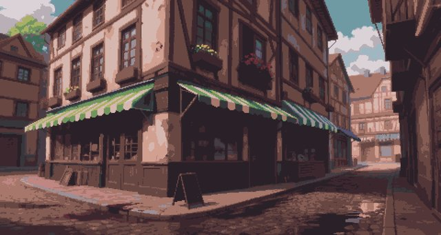
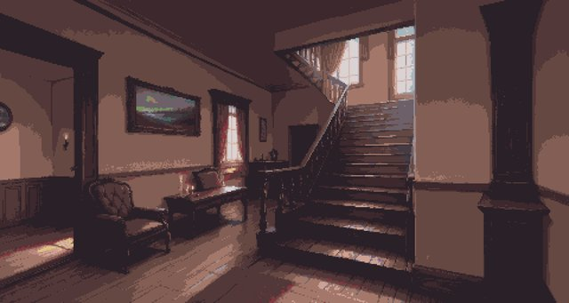
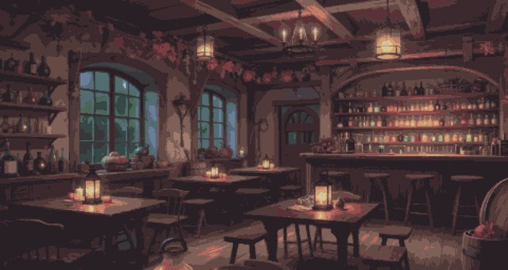
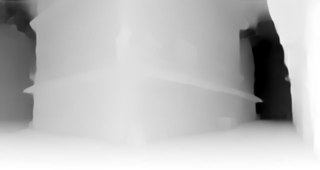
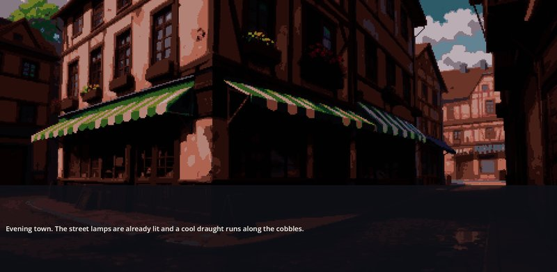
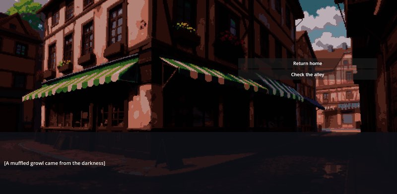

# Town Pack — фоны города, дома и бара со звуком бара

Town Pack — готовые декорации для истории в небольшом городке. Внутри три нарисованных фона — угловая улица у въезда в город, прихожая дома и вечерний бар — и зацикленный звук атмосферы бара. Сюжета, сцен и персонажей в моде нет: где показывать эти картинки, решает игра.

Две встроенные игры уже делят этот набор. **Cthangover** берёт въезд в город и прихожую, шаблон **My Novel** — все три фона и звук бара. Поскольку обе игры берут одни и те же файлы из этого мода, исправление или улучшенная картинка в Town Pack достаются им обеим.

## Что внутри

Въезд в город, `town/town_entry`: мощёный уличный угол с полосатыми навесами магазинов.



Прихожая дома, `home/vestibule`: зал с лестницей, креслом и картиной.



Бар, `bar/bar`: столики с фонарями, стойка и полки с бутылками.



Атмосфера бара, `bar/bar_ambient`: зацикленный Ogg Vorbis с гулом бара для звукового канала Ambience.

Все три картинки — размером 1920 × 1024. У каждой есть серый файл-спутник с тем же именем и суффиксом `_depth`:



Картинку глубины вы напрямую не видите. Показывая фон, игра подгружает `<name>_depth` и передаёт его системе освещения — та использует его для источников света, размещённых поверх сцены. Фон без файла глубины тоже показывается как обычно.

## Где вы это увидите

- **Cthangover:** сцена `town_entry` (въезд в город) и сцена `home_vestibule`.
- **Шаблон My Novel:** `my_novel_town`, `my_novel_home` и `my_novel_bar`. В сцене бара играет и `bar/bar_ambient`.

Тот же въезд в город в шаблоне My Novel: с него и строки рассказа начинается игра:



А в Cthangover поверх той же картинки другой сюжет предлагает свои варианты:



Town Pack входит в коллекции обеих игр и загружается вместе с ними. Сама по себе установка не добавит эти места в чужую игру: фон должен использоваться в сценах самой игры.

## Используйте фоны в своей игре

1. Добавьте `town_pack>=1` в список `depends` своего контентного мода.
2. Включите `town_pack>=1` в коллекцию своей игры — так, как это делает шаблон My Novel в блоке **Assets**.
3. Обращайтесь к ресурсам по именам из списка ниже. Имена считаются относительно `backgrounds/` и `sounds/` и пишутся без расширения.

```jsonc
// mods/my_game/manifest.json — добавьте к существующему списку
"depends": ["town_pack>=1"]
```

Сцена, которая показывает бар и включает его атмосферу, — из шаблонной сцены `my_novel_bar`:

```json
{
  "name": "my_bar",
  "defaultBackground": "bar/bar",
  "defaultAmbient": "bar/bar_ambient"
}
```

Сценарий может сменить картинку и посреди диалога:

```scenario
background town/town_entry
text "В такой час улица пустует."
```

Доступные имена:

```text
town/town_entry     backgrounds/town/town_entry.png
home/vestibule      backgrounds/home/vestibule.png
bar/bar             backgrounds/bar/bar.png
bar/bar_ambient     sounds/bar/bar_ambient.ogg
```

## Как заменить картинку для своей игры

Чтобы заменить картинку, не трогая Town Pack, положите в свой мод файл с тем же относительным именем — например, `backgrounds/bar/bar.png` — и объявите в его `depends` зависимость `town_pack>=1`. Зависимый мод загружается позже и побеждает. Заменяя фон, положите рядом и одноимённый файл `_depth`: иначе игра найдёт исходную картинку глубины из Town Pack, и свет ляжет по композиции старой картинки.

Без зависимости порядок двух модов с одним и тем же именем не определён; карта ресурсов сообщает об этом как об ошибке.

## Если чего-то не хватает

1. Чёрный или пропавший фон обычно означает опечатку в имени. Имена чувствительны к регистру, разделитель — `/`.
2. Проверьте, что Town Pack включён в запущенную игру, а не просто установлен.
3. Нет звука бара: проверьте, что `defaultAmbient` сцены — `bar/bar_ambient`, а канал **Ambience** включён в **Settings → Sound**. Звук воспроизводит мод Audio Engine.
